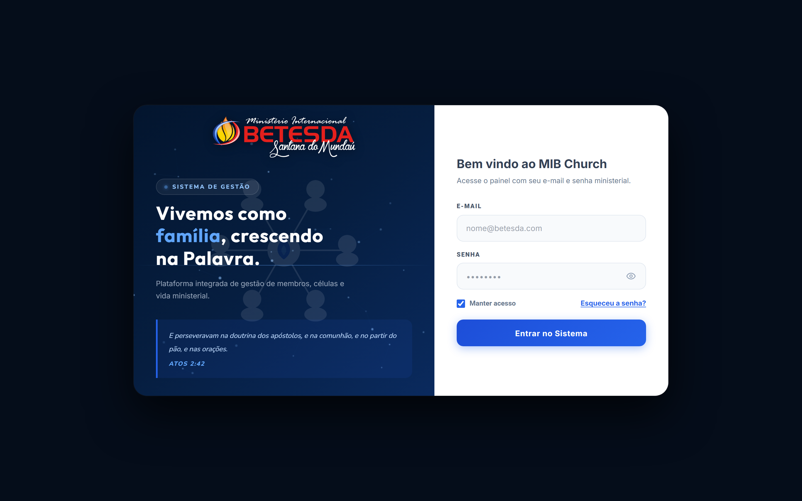
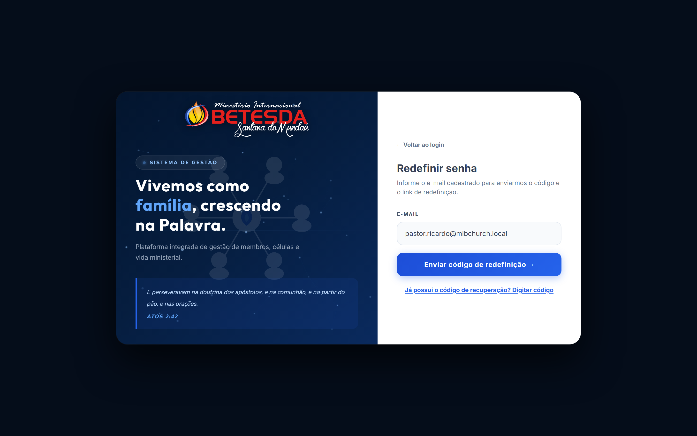
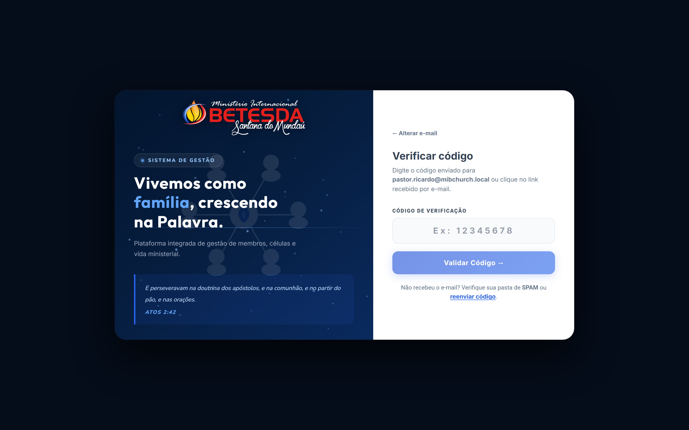

# Apostila Técnica — MIB Church: Mapeamento Completo do Sistema

> **Capítulo 1 — Tela de Login & Autenticação (`TelaLogin.jsx`)**  
> Versão 1.0 • Ambiente de Documentação com Dados Demonstrativos  
> Arquivo principal: [`src/TelaLogin.jsx`](../../src/TelaLogin.jsx) • Orquestração: [`src/App.jsx`](../../src/App.jsx)

---

## Sumário do Capítulo 1

1. [Visão Geral e Ponto de Entrada (`App.jsx` → `TelaLogin.jsx`)](#1-visão-geral-e-ponto-de-entrada)
2. [Estrutura Visual da Tela de Login — Ordem de Exibição](#2-estrutura-visual-da-tela-de-login--ordem-de-exibição)
   - [2.1 Painel Esquerdo (Identidade Institucional)](#21-painel-esquerdo-identidade-institucional-tl-left)
   - [2.2 Painel Direito (Formulário Principal — `MODO.LOGIN`)](#22-painel-direito-formulário-principal--modologin)
3. [Fluxos Secundários e Modos de Recuperação (`MODO`)](#3-fluxos-secundários-e-modos-de-recuperação-modo)
   - [3.1 Modo `ESQUECEU` — Solicitação de Redefinição](#31-modo-esqueceu--solicitação-de-redefinição)
   - [3.2 Modo `VERIFICAR_CODIGO` — Validação OTP](#32-modo-verificar_codigo--validação-otp)
   - [3.3 Modo `NOVA_SENHA` — Criação da Nova Senha](#33-modo-nova_senha--criação-da-nova-senha)
   - [3.4 Modo `ALTERAR_SENHA_PADRAO` — Troca Obrigatória no Primeiro Acesso](#34-modo-alterar_senha_padrao--troca-obrigatória-no-primeiro-acesso)
4. [Adaptação Responsiva (Mobile `<= 700px`)](#4-adaptação-responsiva-mobile--700px)
5. [Regras de Negócio, Segurança e Sessão](#5-regras-de-negócio-segurança-e-sessão)

---

## 1. Visão Geral e Ponto de Entrada

Em [`src/App.jsx`](../../src/App.jsx), antes de exibir qualquer módulo interno, o sistema verifica se o usuário está autenticado (`!usuarioLogado || (!carregando && !membroLogado && pessoas.length === 0)`), salvo nas rotas públicas (`/cadastro-publico`, `/inscricao-evento/:id` e `/confirmar-escala`). Quando não há sessão válida, é renderizado o componente [`TelaLogin`](../../src/TelaLogin.jsx).

O layout é construído em um cartão centralizado (`.tl-card`, largura máxima `960px`) sobre fundo escuro `#050d1a`, dividido em **duas colunas no desktop** (`1fr 420px`):
- **Esquerda (`.tl-left`)**: identidade visual, animação de partículas, lema e versículo.
- **Direita (`.tl-right`)**: formulários reativos controlados pelo estado `modo` (`MODO`).

---

## 2. Estrutura Visual da Tela de Login — Ordem de Exibição

### 2.1 Painel Esquerdo: Identidade Institucional (`.tl-left`)

Ordenado pelas camadas e blocos de cima para baixo dentro da coluna esquerda:

| Ordem | Elemento / Classe CSS | Implementação | Comportamento / Responsividade |
| :---: | :--- | :--- | :--- |
| **1** | **Canvas de Partículas (`.tl-canvas`)** | `<canvas ref={canvasRef} />` | Desenha 38 partículas luminosas animadas via `requestAnimationFrame` conectadas por linhas sutis quando `dist < 110px`. |
| **2** | **Ilustração Vetorial (`.tl-illustration`)** | SVG inline (6 nós + chama central) | Marca d'água central translúcida (`opacity: 0.10`) representando a comunhão em células. Oculta no mobile (`<= 700px`). |
| **3** | **Linha de Luz Horizontal (`.tl-glow-line`)** | Gradiente linear azul | Divisor luminoso decorativo em `top: 55%`. Oculto no mobile. |
| **4** | **Logotipo (`.tl-logo-wrap` → `.tl-logo-img`)** | `/logo-betesda-mundau.png` | Posicionado no topo; centralizado automaticamente em telas mobile (`<= 700px`). |
| **5** | **Badge de Módulo (`.tl-badge`)** | `.tl-badge-dot` + `"Sistema de Gestão"` | Pílula translúcida com ponto azul pulsante acima do título. Oculta no mobile. |
| **6** | **Título / Lema (`.tl-headline`)** | `h1` (`Cinzel`) + `
` | *"Vivemos como **família**, crescendo na Palavra."* + subtítulo institucional (subtítulo oculto no mobile). |
| **7** | **Card de Versículo (`.tl-verse`)** | `<q>` + `<cite>Atos 2:42</cite>` | Bloco com borda esquerda azul na base do painel. Oculto no mobile. |

---

### 2.2 Painel Direito: Formulário Principal — `MODO.LOGIN`

Ordenado exatamente de cima para baixo no formulário padrão de acesso:

| Ordem | Componente / Campo | ID / Classe | Função Técnica e Interação |
| :---: | :--- | :--- | :--- |
| **1** | **Título e Subtítulo** | `.tl-right-title`, `.tl-right-sub` | Exibe *"Bem vindo ao MIB Church"* e instrução *"Acesse o painel com seu e-mail e senha ministerial."* |
| **2** | **Campo E-mail** | `#email` (`.tl-input`) | Recebe o e-mail do usuário; no evento `onBlur`, chama `buscarPerfilNoBanco(email)` consultando `pessoas.permissao`. |
| **3** | **Chip "Perfil identificado"** *(condicional)* | `.tl-perfil-chip` | Exibido quando o e-mail é encontrado na tabela `pessoas`, mostrando sigla (`AD`, `PR`, `LC`, `MB`, `SC`, `TS`) e nome do perfil. |
| **4** | **Campo Senha + Olho** | `#senha` + `.tl-toggle-pwd` | Campo mascarado com botão lateral (`Eye` / `EyeOff` do `lucide-react`) para alternar visualização da senha. |
| **5** | **Linha de Ações** | `.tl-actions-row` | À esquerda: checkbox **Manter acesso** (`lembrar`). À direita: link **Esqueceu a senha?** (altera para `MODO.ESQUECEU`). |
| **6** | **Alerta de Erro** *(condicional)* | `.tl-alert-err` | Exibe mensagens amigáveis traduzidas (ex.: *"E-mail ou senha incorretos."* ou *"Informe e-mail e senha."*). |
| **7** | **Botão "Entrar no Sistema"** | `.tl-btn-primary` | Executa `handleLogin`: autentica via `supabase.auth.signInWithPassword`, busca perfil/permissões em `pessoas` e verifica se a senha é temporária. |

---

## 3. Fluxos Secundários e Modos de Recuperação (`MODO`)

O painel direito alterna entre 5 estados definidos pela constante `MODO`:

| Modo (`MODO`) | Título Exibido | Entrada Principal | Ação Executada no Supabase |
| :--- | :--- | :--- | :--- |
| `LOGIN` | Bem vindo ao MIB Church | E-mail + Senha | `supabase.auth.signInWithPassword` + leitura de `pessoas` |
| `ESQUECEU` | Redefinir senha | E-mail cadastrado | `supabase.auth.resetPasswordForEmail` |
| `VERIFICAR_CODIGO` | Verificar código | Código OTP (6 a 8 dígitos) | `supabase.auth.verifyOtp({ type: 'recovery' })` |
| `NOVA_SENHA` | Criar nova senha | Nova senha + Confirmação | `supabase.auth.updateUser` + `signOut()` |
| `ALTERAR_SENHA_PADRAO` | Definir senha definitiva | Nova senha definitiva + Confirmação | `supabase.auth.updateUser` + `onEntrar(dadosUsuarioTemp)` |

### 3.1 Modo `ESQUECEU` — Solicitação de Redefinição

1. Botão superior **← Voltar ao login** (`.tl-back`).
2. Campo **E-mail** (`#email-reset`).
3. Botão **Enviar código de redefinição →** (`supabase.auth.resetPasswordForEmail` com `redirectTo: window.location.origin + '/?reset=1'`).
4. Link inferior **Já possui o código de recuperação? Digitar código** para ir direto a `MODO.VERIFICAR_CODIGO`.

### 3.2 Modo `VERIFICAR_CODIGO` — Validação OTP

1. Link **← Alterar e-mail** para retornar ao passo anterior.
2. Campo numérico centralizado `#codigo-otp` (aceita apenas dígitos, 6 a 8 caracteres, com espaçamento largo).
3. Botão **Validar Código →** (habilitado a partir de 6 dígitos), validando o token via `supabase.auth.verifyOtp`.
4. Rodapé com orientação para verificar SPAM e botão **reenviar código**.

### 3.3 Modo `NOVA_SENHA` — Criação da Nova Senha
Ativado tanto após validar o código OTP quanto automaticamente no carregamento quando a URL contém parâmetros de recuperação (`type=recovery`, `access_token`, `reset=1`, `code=`) ou via listener `onAuthStateChange` (`PASSWORD_RECOVERY`). Possui campos `#nova` e `#confirmar` com botões olho individuais, exigindo mínimo de 6 caracteres e encerrando a sessão temporária após salvar para que o usuário faça login limpo.

### 3.4 Modo `ALTERAR_SENHA_PADRAO` — Troca Obrigatória no Primeiro Acesso
Ao autenticar com sucesso em `handleLogin`, se a senha digitada estiver na lista de senhas padrão temporárias (`mib123`, `mib@123`, `mudar123`, `senha123`, `123456`, `12345678`, `mib2026`, `igreja123`, `mib2026@`, `mibchurch`), o acesso é retido em `dadosUsuarioTemp` e o formulário exige o cadastro de uma senha definitiva (`>= 6` caracteres) antes de liberar o painel via `onEntrar`.

---

## 4. Adaptação Responsiva (Mobile `<= 700px`)

Em telas menores ou iguais a `700px`:
- O grid horizontal transforma-se em coluna única (`flex-direction: column`, ocupando `100dvh`).
- O painel esquerdo (`.tl-left`) passa a ocupar `38vh` (`min-height: 220px`), ocultando ilustração SVG, badge, subtítulo e versículo para destacar exclusivamente o **logotipo centralizado** e o **lema principal**.
- O painel direito (`.tl-right`) preenche o restante da altura (`flex: 1`) com títulos centralizados e campos adaptados para toque.

---

## 5. Regras de Negócio, Segurança e Sessão

1. **Verificação automática na montagem (`useEffect`)**: consulta `supabase.auth.getSession()`. Se existir sessão ativa **sem** registro correspondente em `localStorage.getItem('mibChurchSessao')` (ex.: usuário fechou o navegador durante a troca obrigatória de senha padrão) e não for link de recuperação, executa `supabase.auth.signOut()` por segurança.
2. **Normalização de Perfis (`normalizarPermissaoLogin`)**: mapeia variações textuais do banco (`administrador` → `admin`, `pastora` → `pastor`, `secretario` → `secretaria`, `financeiro`/`tesoureiro` → `tesouraria`, `supervisor`/termos com `lider`/`celula` → `lider-celula`) para os 6 perfis oficiais.
3. **Tradução de Erros (`traduzirErroAuth`)**: converte mensagens técnicas do Supabase Auth (rate limit de 60s, OTP expirado, credenciais inválidas, usuário não encontrado) em mensagens claras em português.

