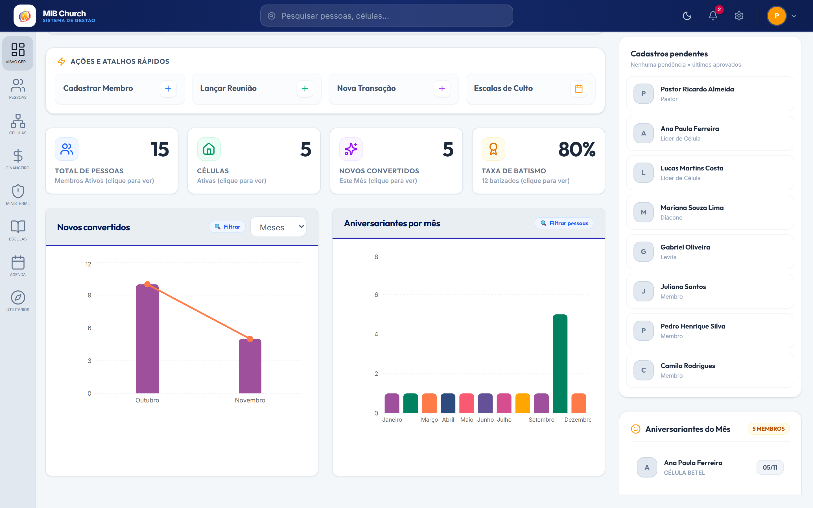
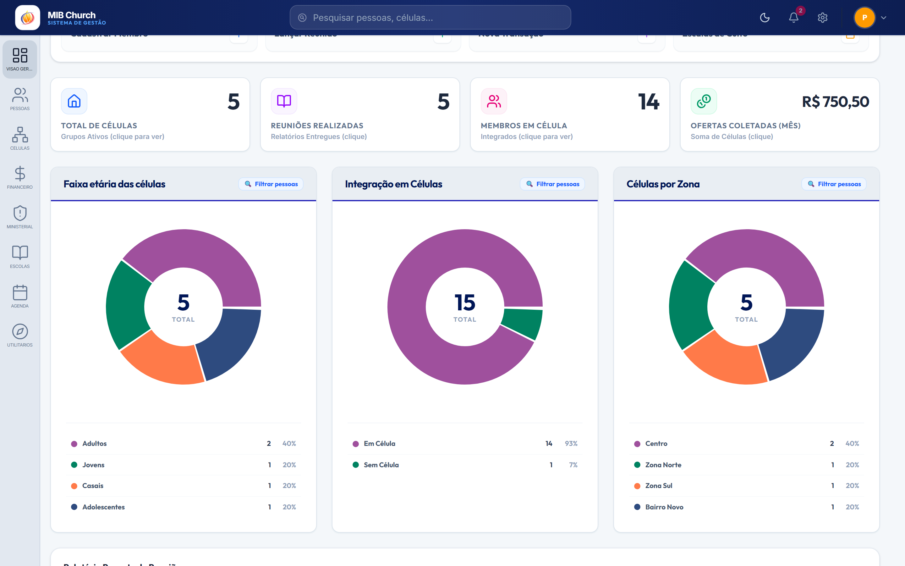
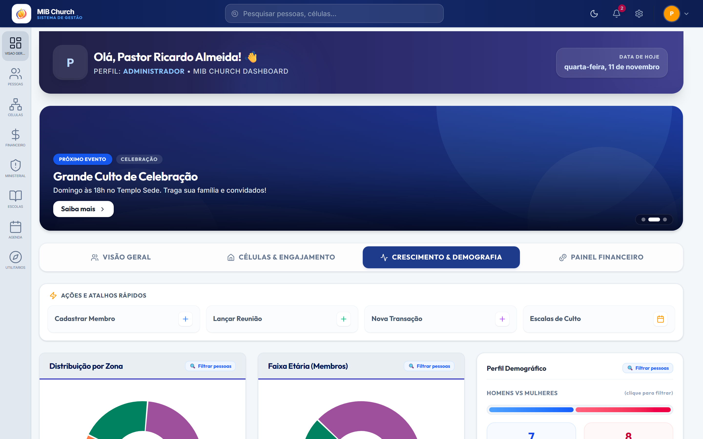
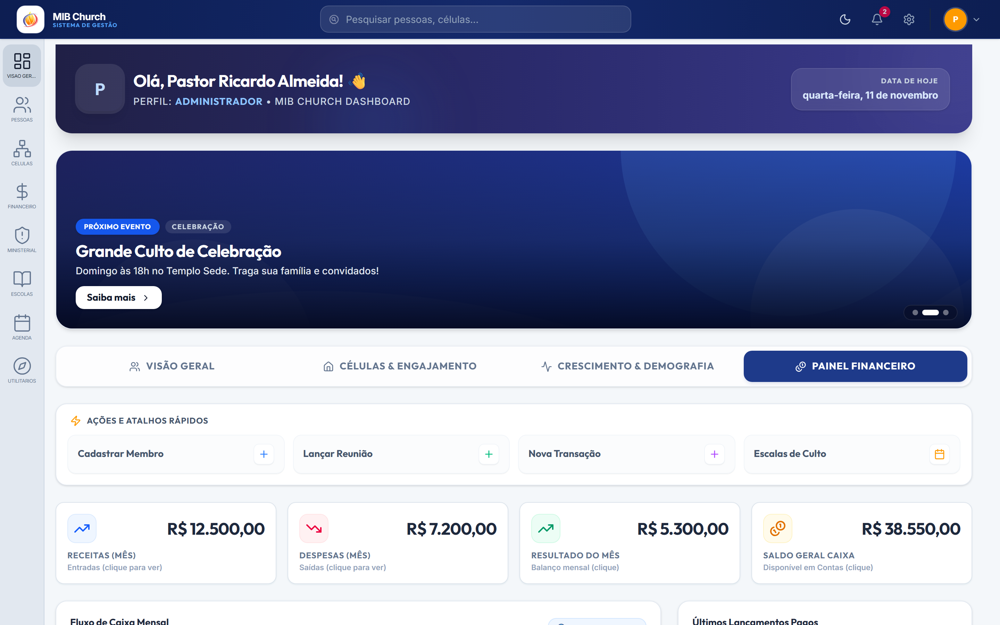
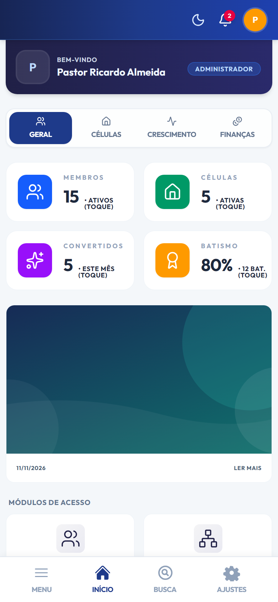
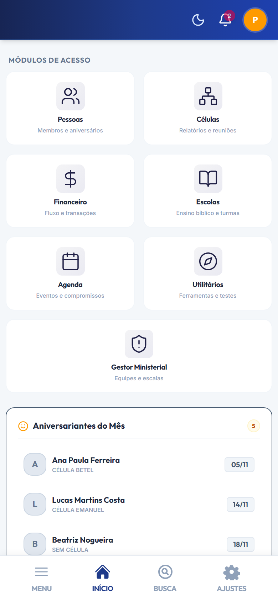
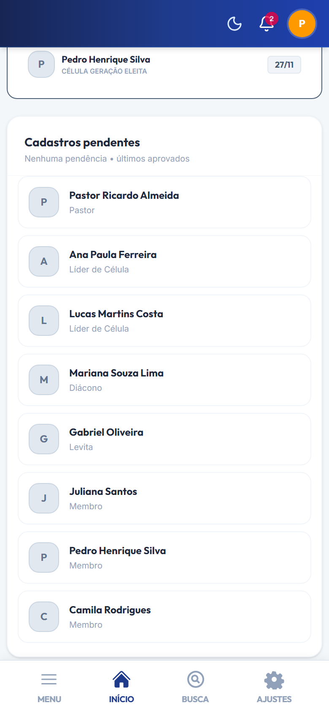
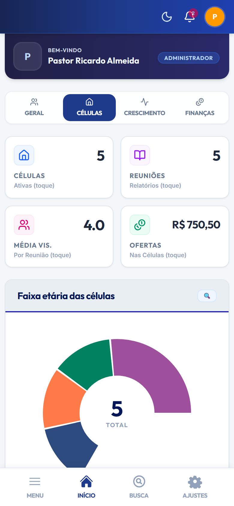
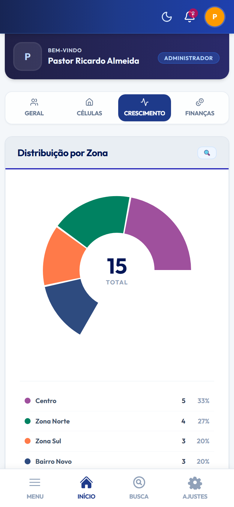
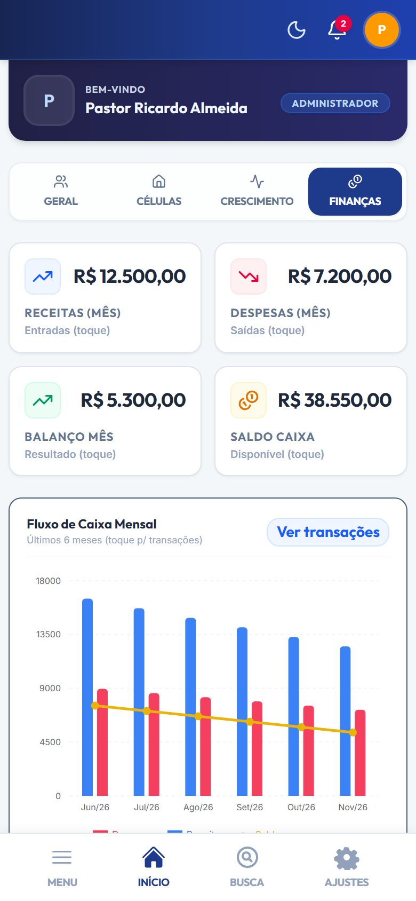

# Apostila Técnica — MIB Church: Mapeamento Completo do Sistema

> **Capítulo 2 — Shell Global & Home Page (Desktop e Mobile)**  
> Versão 1.0 • Ambiente de Documentação com Dados Demonstrativos  
> Arquivos-chave: [`src/App.jsx`](../../src/App.jsx), [`src/OverviewDashboard.jsx`](../../src/OverviewDashboard.jsx), [`src/HomePage.jsx`](../../src/HomePage.jsx), [`src/PainelAprovacoes.jsx`](../../src/PainelAprovacoes.jsx), [`src/ui.jsx`](../../src/ui.jsx)

---

## Sumário do Capítulo 2

1. [Visão Arquitetural e Roteamento da Home Page](#1-visão-arquitetural-e-roteamento-da-home-page)
2. [Shell Global de Navegação (`App.jsx`)](#2-shell-global-de-navegação-appjsx)
   - [2.1 Cabeçalho Superior Desktop (`<header>`)](#21-cabeçalho-superior-desktop-header)
   - [2.2 Barra Lateral Desktop e Submenus Flyout (`<aside>`)](#22-barra-lateral-desktop-e-submenus-flyout-aside)
   - [2.3 Cabeçalho Mobile e Barra Inferior Fixa](#23-cabeçalho-mobile-e-barra-inferior-fixa)
3. [Home Page Desktop (`OverviewDashboard.jsx`) — Ordem de Exibição](#3-home-page-desktop-overviewdashboardjsx--ordem-de-exibição)
   - [3.1 Blocos Fixos Superiores](#31-blocos-fixos-superiores)
   - [3.2 Aba 1 — Visão Geral (Coluna Principal + Coluna Direita Fixa)](#32-aba-1--visão-geral-coluna-principal--coluna-direita-fixa)
   - [3.3 Aba 2 — Células & Engajamento](#33-aba-2--células--engajamento)
   - [3.4 Aba 3 — Crescimento & Demografia](#34-aba-3--crescimento--demografia)
   - [3.5 Aba 4 — Painel Financeiro](#35-aba-4--painel-financeiro)
4. [Home Page Mobile (`HomePage.jsx`) — Ordem de Exibição](#4-home-page-mobile-homepagejsx--ordem-de-exibição)
   - [4.1 Cabeçalho, Abas e Aba Geral](#41-cabeçalho-abas-e-aba-geral)
   - [4.2 Abas Células, Crescimento e Finanças no Mobile](#42-abas-células-crescimento-e-finanças-no-mobile)
5. [Fluxo de Dados e Performance](#5-fluxo-de-dados-e-performance)

---

## 1. Visão Arquitetural e Roteamento da Home Page

Após autenticar-se em [`TelaLogin`](01-tela-de-login.md), o orquestrador principal [`src/App.jsx`](../../src/App.jsx) carrega os dados base em paralelo via `obterDados()` (`pessoas`, `cargos`, `atuacoes`, `celulas`, `zonas_moradia` e `relatorios_celula`) e define qual experiência inicial é exibida no módulo `'dashboard'` conforme o **perfil de permissão** e a **largura de tela (`isDesktop`)**:

| Condição de Perfil / Viewport | Componente Renderizado | Observação |
| :--- | :--- | :--- |
| Apenas Líder de Célula (`isApenasLiderCelula`) | `DashboardLider` | Visão focada apenas nas células sob sua liderança |
| Perfil Membro (`permissao === 'membro'`) | `DashboardMembro` | Portal pessoal do membro (escala, perfil, oração) |
| Demais Perfis em Desktop (`>= 768px`) | `OverviewDashboard` | Painel analítico completo com coluna lateral fixa |
| Demais Perfis em Mobile (`< 768px`) | `HomePage` | Layout empilhado com atalhos de módulos em grid 2x2 |

> **Nota técnica:** O controle responsivo usa `window.matchMedia('(min-width: 768px)')` (`isDesktop`), garantindo que apenas a interface ativa no dispositivo seja montada no DOM, evitando requisições e renderizações duplicadas.

---

## 2. Shell Global de Navegação (`App.jsx`)

Antes do conteúdo específico da Home Page, o sistema renderiza a moldura persistente de navegação em [`src/App.jsx`](../../src/App.jsx).

### 2.1 Cabeçalho Superior Desktop (`<header>`)
Fixo no topo (`fixed top-0 inset-x-0 z-50 h-14`), exibido da esquerda para a direita:
1. **Botão Logotipo & Identidade**: exibe `/logo-mib-mundau.png`, título **"MIB Church"** e subtítulo **"Sistema de Gestão"**. Retorna imediatamente para `dashboard`.
2. **Busca Global (`BuscaGlobal`)**: barra central de pesquisa instantânea sobre `pessoasVisiveis` e `celulasVisiveis`. Ao selecionar um resultado, redireciona diretamente para a ficha do membro (`DetalhesMembro`) ou detalhes da célula.
3. **Alternador de Tema (`Sun` / `Moon`)**: alterna entre Modo Claro e Modo Escuro via `handleAlternarTema`.
4. **Central de Notificações (`Bell`)**: exibe contador pulsante (`notificacoesAtivas.length`) e abre o painel com alertas de reuniões não vistas, aniversariantes e substituições de escalas.
5. **Botão Configurações (`Settings`)**: visível apenas quando `hasAccess('Configurações')` é verdadeiro.
6. **Menu do Usuário (`UserAvatarDropdown`)**: mostra avatar/inicial do usuário logado com atalho para **Meu Perfil** e botão **Sair** (`handleSair`).

### 2.2 Barra Lateral Desktop e Submenus Flyout (`<aside>`)
Fixa à esquerda (`fixed left-0 top-14 bottom-0 z-40 w-16`), composta por botões `<SideNavBtn />` filtrados dinamicamente por `hasAccess(modulo)`. Ao passar o mouse ou clicar, abre um menu flutuante lateral (*flyout*) com os submenus autorizados, na seguinte ordem vertical:

1. **Visão Geral** (`dashboard`)
2. **Pessoas** (`Ver todos`, `Adicionar pessoa`, `Link de Autocadastro`, `Membros Inativos`, `Aniversariantes`, `Cargos`, `Zonas`, `Atuações`, `Relatórios`)
3. **Células** (`Painel Geral`, `Lista de células`, `Nova célula`, `Reuniões`, `Relatórios`)
4. **Financeiro** (`Resumo`, `Transações`, `Relatórios financeiros`, `Categorias`, `Contas`, `Importar`, `Logs`)
5. **Gestão Ministerial** (`Dashboard`, `Ministérios`, `Escalas`, `Relatórios`, `Histórico`)
6. **Escolas** (`Visão Geral`, `Cursos`, `Turmas`, `Disciplinas`, `Professores`, `Alunos`, `Aulas`, `Avaliações`, `Ficha do Aluno`, `Inscrições Públicas`)
7. **Agenda** (`Calendário`, `Eventos`, `Mural de Avisos`)
8. **Utilitários** (`Visão Geral`, `Calculadora de Tributos`, `Relatório Semanal`, `Ficha de Visitante`, `Pedido de Oração`, `Mural de Orações`, `Teste de Temperamento`, `Gerador de Carnê`, `Leitor de Carnê`, `Escalas Ministerial`)

### 2.3 Cabeçalho Mobile e Barra Inferior Fixa
* **Faixa Superior Mobile (`md:hidden`)**: botão voltar contextual (`ChevronLeft`), alternador de tema, sino de notificações, botão de filtro contextual (em *Pessoas* e *Transações*) e avatar de perfil rápido.
* **Barra Inferior Fixa (`nav` inferior)**: 4 atalhos fixos — **Menu** (abre o drawer completo com submenus sanfonados), **Início**, **Busca** (`BuscaMobileOverlay`) e **Ajustes**.

---

## 3. Home Page Desktop (`OverviewDashboard.jsx`) — Ordem de Exibição

### 3.1 Blocos Fixos Superiores
Os 4 blocos abaixo permanecem no topo do `OverviewDashboard` independentemente da aba selecionada:

| Ordem | Componente / Bloco | Fonte de Dados | Funcionalidade Principal |
| :---: | :--- | :--- | :--- |
| **1** | **Cabeçalho de Boas-Vindas Premium** | `membroLogado`, `usuarioLogado` | Exibe avatar (`foto_url` ou inicial), saudação `"Olá, {nomeUsuario}!"`, perfil (`cargoUsuario`) e data corrente formatada em português. |
| **2** | **Carrossel de Banners de Eventos e Avisos** | `agenda_eventos` + `mural_avisos` | Busca paralela com `Promise.all` (fallback para 3 banners padrão). Troca automática a cada 5s (pausada no hover), setas laterais, *dots* e botão **Saiba mais**. |
| **3** | **Menu de Abas (`Tabs Navigation`)** | Estado `abaAtiva` | Alterna entre **Visão Geral**, **Células & Engajamento**, **Crescimento & Demografia** e **Painel Financeiro** (oculto se `!hasAccess('Financeiro')`). |
| **4** | **Ações e Atalhos Rápidos (`Launchpad`)** | `onNavigate`, `podeVerFinanceiro` | Grade de 4 botões de acesso imediato: *Cadastrar Membro*, *Lançar Reunião*, *Nova Transação* e *Escalas de Culto*. |

---

### 3.2 Aba 1 — Visão Geral (Coluna Principal + Coluna Direita Fixa)

#### Coluna Principal (Esquerda)
5. **Grid de 4 `StatCard`s KPI** (`src/ui.jsx`):
   * **Total de Pessoas**: contagem de `pessoasAtivas` (`status !== 'inativo'`). Clique abre a lista completa de membros.
   * **Células**: total de células visíveis (`celulas.length`). Clique abre o módulo de células.
   * **Novos Convertidos**: membros com `data_conversao` no mês e ano correntes. Clique abre a lista filtrada de novos convertidos do mês.
   * **Taxa de Batismo**: percentual calculado sobre `batizado_aguas === true` e total absoluto no rodapé do card. Clique filtra membros batizados.
6. **Gráfico Combinado (`CombinationCard`) — "Novos convertidos"**:
   * Renderizado com Recharts (barras + linha de tendência) usando `novosConvertidosTrend`.
   * Possui seletor **Meses / Anos** (`periodoConvertidos`). Clicar em qualquer barra direciona para o módulo *Pessoas* filtrado por aquele período.
7. **Gráfico de Colunas (`ColumnChart`) — "Aniversariantes por mês"**:
   * Distribuição cronológica de Janeiro a Dezembro (`aniversariosDados`). Clicar na barra de um mês abre a lista filtrada de aniversariantes daquele mês.

#### Coluna Lateral Direita Fixa (`<aside> lg:fixed`)
8. **Painel de Aprovações & Cadastros Recentes (`<PainelAprovacoes />`)** — [`src/PainelAprovacoes.jsx`](../../src/PainelAprovacoes.jsx):
   * Recebe `pessoas` diretamente de `OverviewDashboard` para exibição instantânea sem requisições extras.
   * Se houver registros com `status === 'pendente'`, destaca-os em cards âmbar para revisão e aprovação.
   * Quando não há pendências (`pendentes.length === 0`), exibe os **8 cadastros ativos mais recentes** ordenados por `created_at` decrescente. Clicar em qualquer linha abre a ficha completa (`DetalhesMembro`).
9. **Card "Aniversariantes do Mês"**:
   * Filtra `pessoasAtivas` nascidas no mês corrente e ordena por dia do mês e nome (`aniversariantesMes`).
   * Cada item exibe `<Avatar />` (com `loading="lazy"` e `decoding="async"`), nome, nome da célula vinculada (ou *"Sem Célula"*) e badge da data (`dd/mm`). Também abre a ficha ao clicar.

---

### 3.3 Aba 2 — Células & Engajamento

Exibida na seguinte ordem vertical:
1. **Grid de 4 `StatCard`s**: *Total de Células*, *Reuniões Realizadas* (`totalReunioes`), *Membros em Célula* e *Ofertas Coletadas (Mês)* (soma de `oferta`/`valor_oferta` dos relatórios do mês corrente).
2. **Grid de 3 `DoughnutCard`s Interativos**:
   * *Faixa etária das células*
   * *Integração em Células* (`Em Célula` vs `Sem Célula`)
   * *Células por Zona*
   * Todas as fatias são clicáveis (`onSliceClick`) para filtrar membros correspondentes em *Pessoas*.
3. **Tabela "Relatório Recente de Reuniões"**:
   * Exibe os 6 relatórios mais recentes (`relatoriosCelula.slice(0, 6)`).
   * Para pastores/administradores, reuniões ainda não visualizadas (`!reunioesVistas`) exibem um indicador azul pulsante.
   * Colunas: *Célula* (clicável para filtrar pessoas), *Participantes*, *Visitantes*, *Data* e botão **Ver pessoas**.

---

### 3.4 Aba 3 — Crescimento & Demografia

1. **Linha 1 (3 colunas):**
   * `DoughnutCard` **Distribuição por Zona** (clicável por zona)
   * `DoughnutCard` **Faixa Etária (Membros)** (clicável por faixa)
   * Card **Perfil Demográfico**: barra dupla interativa **Homens vs Mulheres** + 2 cards clicáveis com totais e percentuais + barra de progresso clicável de **Membros Batizados nas Águas**.
2. **Linha 2 (3 colunas):**
   * `DoughnutCard` **Estado Civil**
   * `ColumnChart` **Cargos e Liderança**
   * `ColumnChart` **Campos de Atuação** (todos com filtragem por clique direcionando ao módulo *Pessoas*).

---

### 3.5 Aba 4 — Painel Financeiro

Carregado sob demanda via `fetchFinanceData()` na tabela `transacoes_financeiras`:
* Caso o usuário não possua permissão RLS no banco, exibe um card de bloqueio (*Acesso Restrito ao Painel Financeiro*).
* Com acesso liberado, exibe na ordem:
  1. **Grid de 4 `StatCard`s**: *Receitas (Mês)*, *Despesas (Mês)*, *Resultado do Mês* e *Saldo Geral Caixa*.
  2. **Gráfico `ComposedChart` — "Fluxo de Caixa Mensal"** (colunas de Receitas, Despesas e linha de Saldo nos últimos 6 meses) + botão **Ver transações**.
  3. **Card Lateral "Últimos Lançamentos Pagos"**: lista as 5 transações mais recentes ordenadas por data decrescente.

---

## 4. Home Page Mobile (`HomePage.jsx`) — Ordem de Exibição

### 4.1 Cabeçalho, Abas e Aba Geral

| Ordem | Topo (Abas & Indicadores) | Grid de Módulos | Aniversariantes & Recentes |
| :---: | :---: | :---: | :---: |
| **Visualização** |  |  |  |

Sequência exata de renderização em telas `< 768px` ([`src/HomePage.jsx`](../../src/HomePage.jsx)):
1. **Cabeçalho Mobile Compacto**: foto/inicial, rótulo *"Bem-vindo"*, nome completo e badge do cargo/perfil.
2. **Menu de Abas Segmentado (Grid 3 ou 4 colunas)**: *Geral*, *Células*, *Crescimento* e *Finanças* (condicionado à permissão).
3. **Na Aba `Geral` (`visao_geral`)**:
   * **Grid 2x2 `CardMobileIndicador`**: *Membros*, *Células*, *Convertidos* e *Batismo*.
   * **Carrossel Mural de Avisos**: cartões deslizantes horizontais com setas, *dots* e abertura de modal (`ModalWrapper`) com HTML formatado ao tocar.
   * **Grid "Módulos de Acesso"**: cartões 2 colunas para acesso direto aos módulos (*Pessoas, Células, Financeiro, Escolas, Agenda, Utilitários, Gestor Ministerial*), respeitando `hasAccess`.
   * **Card "Aniversariantes do Mês"**: lista compacta com `<Avatar />`, célula e dia/mês.
   * **Painel de Aprovações (`<PainelAprovacoes />`)**: pendentes ou últimos 8 aprovados.

### 4.2 Abas Células, Crescimento e Finanças no Mobile

| Aba Células | Aba Crescimento | Aba Finanças |
| :---: | :---: | :---: |
|  |  |  |

Todas as demais abas espelham as métricas e gráficos interativos do Desktop em layout empilhado de coluna única otimizado para toque (incluindo cartões de *Reuniões Recentes* na aba *Células* e *Últimos Lançamentos* na aba *Finanças*).

---

## 5. Fluxo de Dados e Performance

1. **Carregamento Paralelo Inicial**: `App.jsx` executa `Promise.all` para `pessoas`, `cargos`, `atuacoes`, `celulas`, `zonas_moradia` e `relatorios_celula` após validar a sessão ativa.
2. **Reaproveitamento em Memória**: todos os gráficos, KPIs, aniversariantes e cadastros recentes da Home Page derivam via `useMemo` da prop `pessoas`, eliminando queries repetidas.
3. **Carregamento Sob Demanda Financeiro**: a tabela `transacoes_financeiras` só é consultada quando o usuário abre a aba **Painel Financeiro**.
4. **Carregamento Assíncrono de Mídia**: `Avatar` utiliza `loading="lazy"` e `decoding="async"` para não bloquear a fila de renderização.

